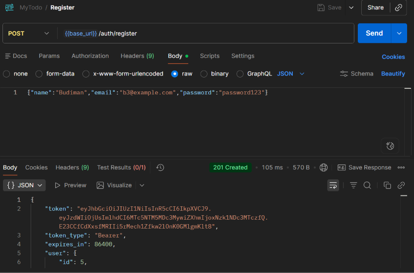
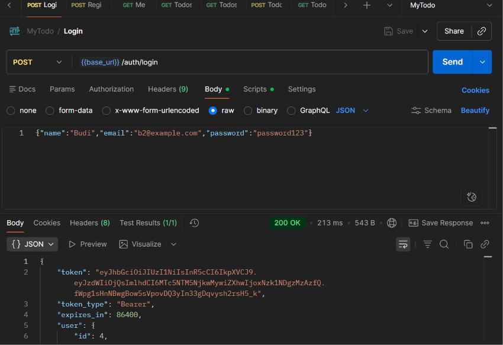
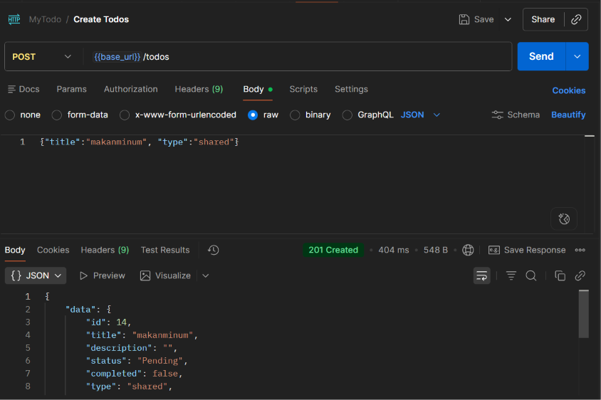
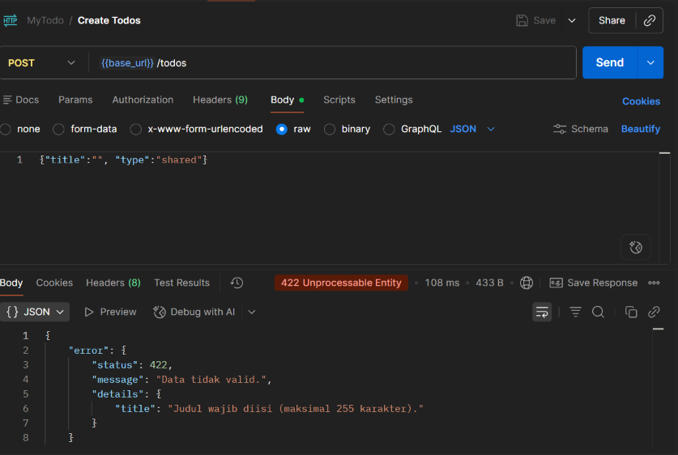
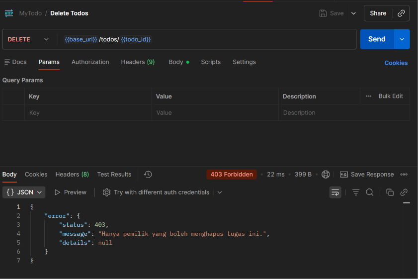
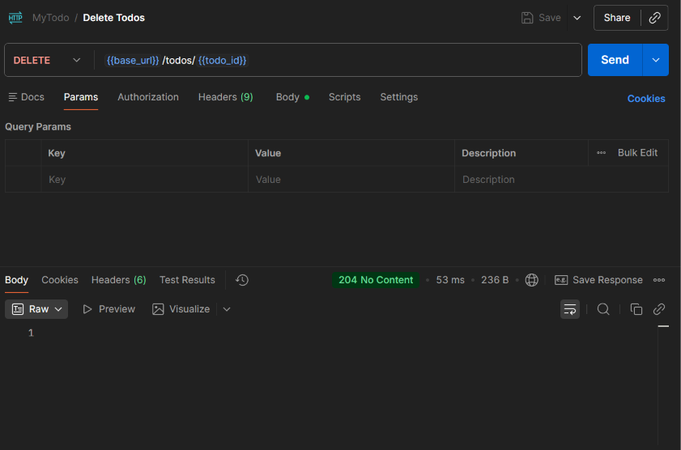
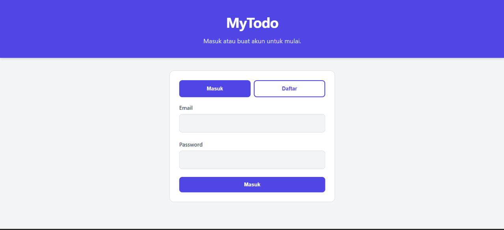
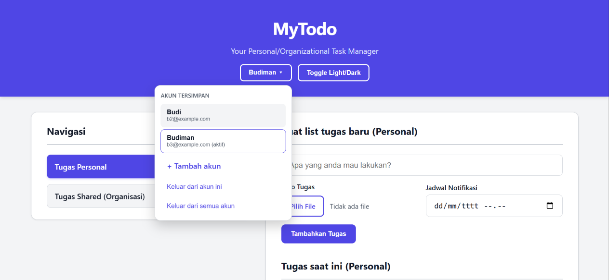
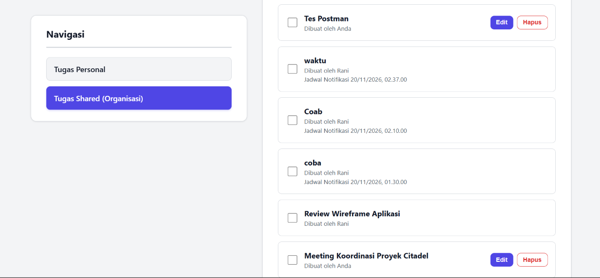

## Deskripsi

### Gambaran Umum

**MyTodo** adalah aplikasi web todo list berbasis **PHP, MySQL, dan JavaScript** dengan **REST API**, **autentikasi JWT**, dukungan **multi-akun**, serta **Progressive Web App** (bisa diinstal dan berjalan offline). Tugas dikelola secara **Personal** (privat per akun) maupun **Shared** (kolaborasi antar akun).

---

## Struktur File

- **`config.php`**: Koneksi PDO ke MySQL, secret JWT, masa berlaku token, batas upload.
- **`data.sql`**: Skema tabel `users` dan `todos` beserta data demo.
- **`api/index.php`**: Router REST API dan handler (auth + CRUD todo).
- **`api/helpers.php`**: Fungsi bantu: respons JSON, JWT, validasi, upload.
- **`api/.htaccess`**: URL bersih dan penerusan header `Authorization`.
- **`index.php`**: Cangkang halaman utama; data diambil lewat `fetch` ke API.
- **`menubar.php`**: Sidebar navigasi Personal / Shared.
- **`auth.html`**: Halaman masuk, daftar, dan tambah akun.
- **`assets/js/auth.js`**: Penyimpanan multi-akun dan fungsi `api()`.
- **`assets/js/app.js`**: UI tugas (list, buat, edit, hapus) dan menu akun.
- **`assets/js/login.js`**: Logika halaman masuk/daftar.
- **`assets/js/script.js`**: Tema, notifikasi pengingat, registrasi SW, tombol install.
- **`assets/css/style.css`**: Variabel tema, tata letak, komponen.
- **`manifest.json`, `sw.js`, `offline.html`, `assets/icons/`**: Komponen PWA (E05).
- **`assets/uploads/`**: Foto bukti tugas.

---

## Fitur

### Akun & Autentikasi
- Daftar dan masuk lewat `POST /api/auth/register` dan `/api/auth/login`; server mengembalikan **JWT (HS256)** yang berlaku **24 jam**. Password disimpan sebagai hash (`password_hash`).
- Multi-akun: **tambah akun**, **ganti akun** tanpa login ulang, **keluar** dari satu atau semua akun.
- Tugas **Personal** hanya terlihat pemiliknya. Tugas **Shared** terlihat semua akun; hanya pemilik yang boleh mengedit/menghapus, anggota lain hanya boleh mengubah status.

### CRUD lewat REST API
- Create (`POST`), Read (`GET`), Update penuh (`PUT`), Update sebagian (`PATCH`), Delete (`DELETE`).

### Unggah File
- Format JPG/PNG/GIF, maksimal 2 MB, isi file divalidasi (bukan hanya ekstensi).
- Disimpan dengan nama acak (`random_bytes`); file fisik dihapus otomatis saat tugas dihapus.

### Caching 
| Resource | Strategi | Alasan |
|:--|:--|:--|
| `offline.html`, CSS, JS, manifest, ikon | Precache + Stale-While-Revalidate | Inti app shell |
| Halaman `index.php`, `auth.html` | Network-First, fallback cache, lalu `offline.html` | Halaman selalu terbaru |
| Foto di `assets/uploads/` | Cache-First | Nama file acak, isinya tidak berubah |
| `/api/*` dan method selain GET | **Network-only** | Cache dikunci per URL, bukan per akun, sehingga berisiko membocorkan data antar-akun |

---

### Endpoint
| Method | Endpoint | Auth | Fungsi |
|:--|:--|:-:|:--|
| POST | `/auth/register` | - | Buat akun, mengembalikan token |
| POST | `/auth/login` | - | Masuk, mengembalikan token |
| GET | `/auth/me` | ✔ | Profil akun aktif |
| GET | `/todos?type=personal\|shared` | ✔ | Daftar tugas (opsional `&status=`) |
| POST | `/todos` | ✔ | Buat tugas (JSON atau form-data + foto) |
| GET | `/todos/{id}` | ✔ | Detail satu tugas |
| PUT | `/todos/{id}` | ✔ | Ganti penuh (`title`, `description`, `status` wajib) |
| PATCH | `/todos/{id}` | ✔ | Ubah sebagian (mis. `{"completed": true}`) |
| DELETE | `/todos/{id}` | ✔ | Hapus tugas |

### Kode Respons
| Endpoint | Sukses | Gagal |
|:--|:--|:--|
| `POST /auth/register` | **201** + token | 400 JSON rusak · 409 email sudah ada · 415 · 422 |
| `POST /auth/login` | **200** + token | 400 · 401 kredensial salah · 415 · 422 |
| `GET /auth/me` | **200** | 401 |
| `GET /todos` | **200** | 401 · 422 parameter salah |
| `POST /todos` | **201** + `Location` | 400 · 401 · 413 gambar >2 MB · 415 format salah · 422 |
| `GET /todos/{id}` | **200** | 400 id bukan angka · 401 · 404 |
| `PUT` / `PATCH /todos/{id}` | **200** | 400 · 401 · 403 bukan pemilik · 404 · 415 · 422 |
| `DELETE /todos/{id}` | **204** tanpa body | 401 · 403 bukan pemilik · 404 |
| Semua endpoint | | 404 rute tidak ada · 405 method salah (+ `Allow`) · 500 error server |

### Format Respons
Sukses: `{ "data": { ... } }` (daftar: `{ "data": [ ... ], "meta": { "count": 3 } }`)

Error (seragam di semua endpoint):
```json
{ "error": { "status": 422, "message": "Data tidak valid.", "details": { "title": "Judul wajib diisi (maksimal 255 karakter)." } } }
```

### Aturan Hak Akses
- Tugas personal milik akun lain dijawab **404** (keberadaannya disamarkan).
- Tugas shared milik akun lain: `GET` dan `PATCH` status boleh; `PUT` dan `DELETE` dijawab **403**.

### Bukti Pengujian 
- Registrasi

- Login

- Tambahkan tugas

- Validasi data tidak valid

- Pelanggaran hak akses

- Hapus tugas


### Bukti Fitur Akun
- Masuk/Daftar

- Ganti Akun

- Tugas
