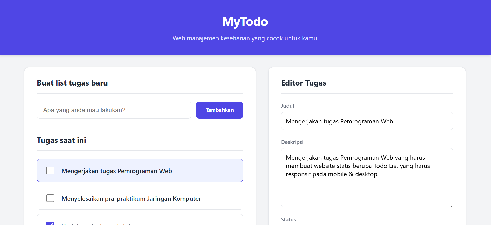
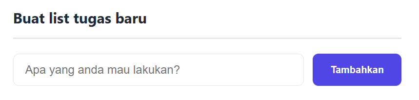
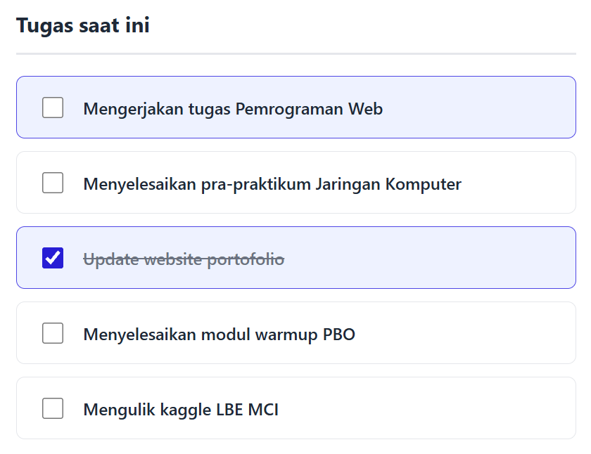
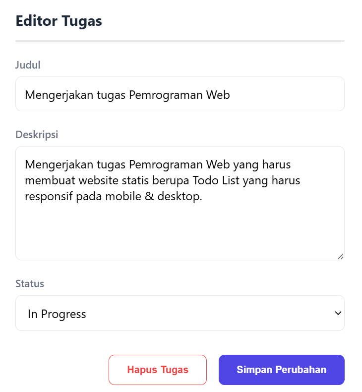
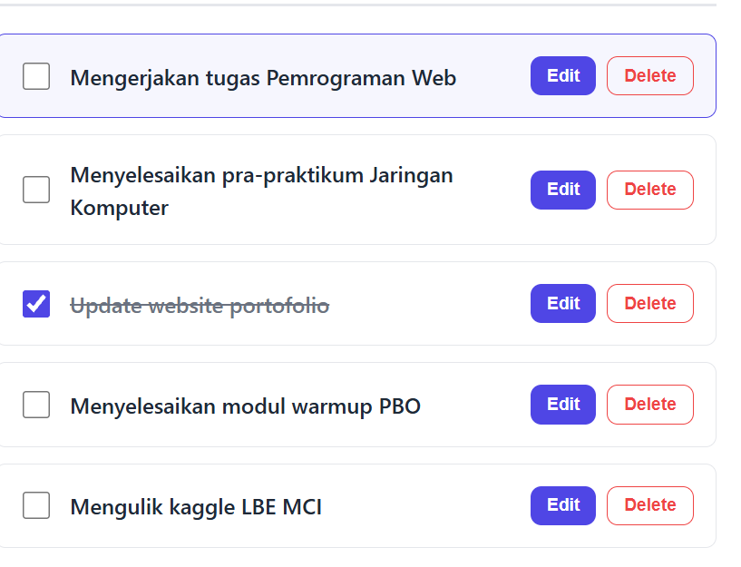
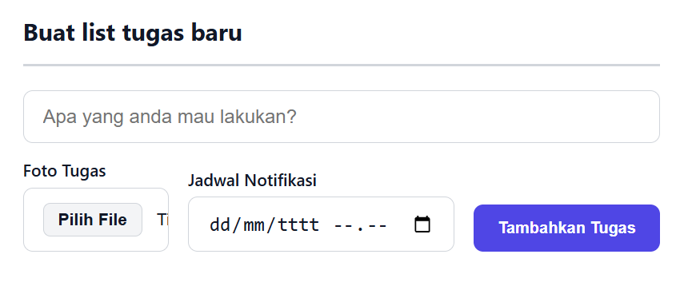
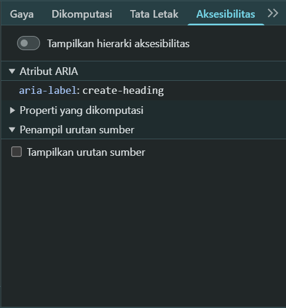
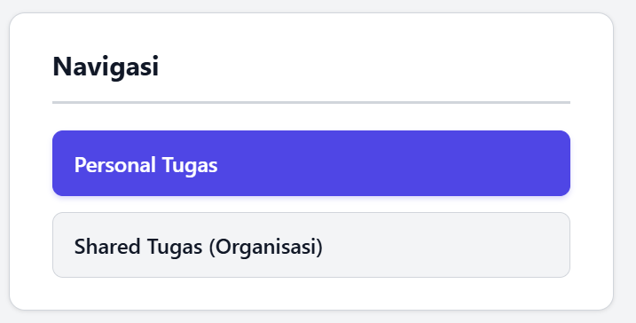

# MyTodo Organizational App - Personal Task Manager

Aplikasi manajemen tugas (Todo List) berbasis **PHP, MySQL, dan CSS3** yang mendukung pengelolaan tugas secara **Personal** maupun **Shared (Organisasi)**. Aplikasi ini dikembangkan sebagai tugas lanjutan untuk mata kuliah Pemrograman Web.

---

## Identitas

|    NRP     |         Nama          |    Kelas    |
| :--------: | :-------------------: | :---------: |
| 5025251100 | Yudith Hafiz Rabbani  |      A      |

---

## Deskripsi

### Gambaran Umum
**MyTodo** telah bertransformasi dari aplikasi *client-side* berbasis IndexedDB menjadi **Aplikasi Web berbasis Server (PHP & MySQL)** yang modular. Aplikasi ini mengusung arsitektur modular PHP, integrasi basis data relasional, pemrosesan unggah file gambar (*File Handling*), serta navigasi navigasi ganda (**Personal** & **Shared**) untuk kolaborasi organisasi.

Aplikasi ini tetap mempertahankan desain antarmuka dua panel yang responsif, fitur *Toggle Light/Dark Mode*, dan standar aksesibilitas berbasis **ARIA**.

---

## Struktur File Modular

Proyek ini dibangun secara modular untuk memudahkan pengelolaan komponen dan integrasi database:

- **`config.php`**: Menyimpan konfigurasi koneksi ke basis data MySQL/MariaDB menggunakan PDO.
- **`index.php`**: Halaman utama yang berfungsi sebagai pendorong logika CRUD, pemrosesan *form* tambah tugas, dan router tampilan data berdasarkan tab aktif.
- **`menubar.php`**: Komponen modular *sidebar* navigasi untuk memilah kategori tugas (**Personal** dan **Shared**).
- **`delete.php`**: Script penanganan proses hapus data tugas dari database sekaligus pembersihan file fisik gambar di server.
- **`data.sql`**: Berkas skema struktur tabel basis data dan data awal dummy.
- **`assets/css/style.css`**: Menyimpan variabel warna (Light/Dark mode), tata letak Flexbox/Grid, serta *responsive breakpoints*.
- **`assets/uploads/`**: Direktori penyimpanan file bukti foto tugas (*File Handling*).

---

## Fitur & Alur Kerja Utama

### 1. Sistem Navigasi Modular (Personal vs Shared)
- **Personal Tugas**: Menampilkan daftar tugas pribadi yang dimiliki pengguna.
- **Shared Tugas (Organisasi)**: Menampilkan tugas-tugas kolaborasi tim/organisasi.
- Navigasi dibuat modular melalui `menubar.php` sehingga mudah dikembangkan lebih lanjut.

### 2. Implementasi CRUD (Create, Read, Delete)
- **Create**: Memasukkan tugas baru lengkap dengan judul, jadwal notifikasi, dan kategori (*Personal/Shared*).
- **Read**: Membaca dan menampilkan daftar tugas sesuai kategori yang sedang dipilih dari database `db_mytodo`.
- **Delete**: Menghapus data tugas dari database relasional.

### 3. Pemrosesan Unggah File (*File Handling*)
- Pengguna dapat mengunggah bukti foto untuk setiap tugas (`.jpg`, `.jpeg`, `.png`, `.gif`).
- File akan disimpan secara fisik ke direktori `assets/uploads/` dengan penamaan terenkripsi acak (menggunakan `md5(time())`).
- Saat tugas dihapus, script secara otomatis akan menghapus file fisik di server menggunakan fungsi `unlink()` untuk menghemat ruang penyimpanan.

### 4. Aksesibilitas (ARIA) & Tema Responsif
- Memanfaatkan atribut `aria-label`, `aria-required`, dan `role` untuk mendukung *Screen Reader*.
- Fitur *Toggle Light/Dark Mode* yang responsif dan nyaman digunakan di berbagai ukuran layar.

---

## Preview Todo App

### Preview Fitur Create (New Sekarang bisa dipakai walau belum persistent)

### Preview Fitur List

### Preview Fitur Editor

### Preview Toggle Light/Dark (New)

### Preview Edit/Delete (New)

### Preview Pelengkap fitur Add

### Preview Aria Accessibility

### Preview Menu Navigasi

### URL Website
[Klik disini](https://if-pemrograman-web-a.github.io/5025251100_Todo-App/)